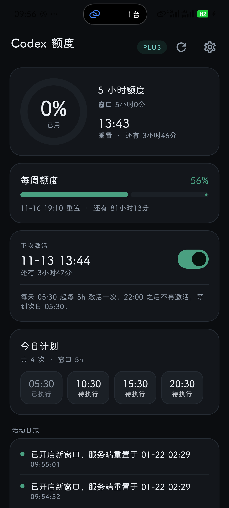

# Codex 额度管家（Codex Quota）

手机端定时"点火"Codex 五小时额度窗口的程序：每天在你设定的时间点自动发一条最小请求，把 5h 窗口首尾相接，到了收工时刻自动停下，第二天再从头开始。



**下载**：[最新版本 APK](https://github.com/307346/codex-quota/releases/latest) · Android 8.0+

## 它解决的是什么问题

Codex 的 5 小时窗口**不是到点自动开启**的，而是"你在重置之后发出的第一条消息"才算开始计时。也就是说，如果 6:00 重置而你 9:00 才打开终端，那这个新窗口要从 9:00 才开始算，中间 3 小时白扔。

这个 App 干的事就是：在重置后几十秒内替你发一条 `Reply with exactly OK.`，让窗口立刻开始，于是下一个窗口的起点也随之提前，一天能多挤出一整轮额度。

## 规则（全部可配置）

| 项 | 默认值 | 说明 |
|---|---|---|
| 每天首次激活 | 05:30 | 一天的链条从这里开始 |
| 窗口长度 | 5 小时 | 从服务端 `limit_window_seconds` 读取，不硬编码 |
| 停止激活 | 22:00 | 计划执行时刻超过它就不再激活 |
| 重置后延迟 | 60 秒 | 躲开服务端边界，避免抢跑失败 |
| 激活模型 | `gpt-6-astra` | 必须填你账号真实可用的 slug |

默认参数下每天的链条是：

```
05:30  →  10:30  →  15:30  →  20:30  →  服务端重置 次日 01:30
                                             ↑ 不在 [05:30, 22:00] 内，跳过
次日 05:30 重新开始
```

判据只有一条：**下一次激活的计划执行时刻，是否落在当天的 `[首次激活, 停止时刻]` 区间内**。落在里面就激活，落在外面就顺延到次日的首次激活时刻。

这一点和"服务端重置时刻是否超过 22:00"是等价的——因为重置时刻加延迟就是计划执行时刻，所以实现里直接用执行时刻判定，边界更清楚（21:58 重置 → 21:59 执行，仍然激活）。

## 目录结构

```
CodexQuota/
├── android/                     Android 原生 App（Kotlin + Compose）
│   ├── app/src/main/java/com/lcs/codexquota/
│   │   ├── core/Scheduler.kt    纯调度算法（无 Android 依赖）
│   │   ├── core/Engine.kt       一轮完整周期：查额度 → 判到期 → 激活 → 排下一轮
│   │   ├── core/AlarmScheduler.kt  精确闹钟
│   │   ├── net/CodexClient.kt   usage / prime / refresh 三个接口
│   │   ├── data/                配置、凭证、DataStore、事件日志
│   │   ├── work/                前台服务、广播接收器、兜底 Worker、通知
│   │   └── ui/                  Compose 界面
│   └── build.gradle.kts
└── tools/codex_quota.py         同一套算法的 Python 参考实现 + 接口探测器
```

`Scheduler.kt` 和 `codex_quota.py` 是同一份逻辑的两种语言实现，后者带完整的自测用例，可以先在电脑上验证行为再上手机。

## 构建

要求：JDK 17（Android Studio 自带的 JBR 即可）。`minSdk 26`（Android 8.0），`targetSdk 35`。

```bash
cd android
./gradlew testDebugUnitTest      # 12 项调度算法单元测试
./gradlew assembleDebug          # Windows 用 gradlew.bat
```

产物：`android/app/build/outputs/apk/debug/app-debug.apk`（约 17 MB）。

**已验证**：本项目在 JDK 17.0.21 + Gradle 8.9 + AGP 8.7.3 + build-tools 35.0.0 下完整编译通过；19 项单元测试全部通过；并且已在一台真实手机（小米 2410DPN6CC / Android 17 / HyperOS V816）上安装运行，真实账号的额度、重置时刻、倒计时、今日计划、活动日志全部与电脑端接口返回一致。

仓库里带了两份本机构建产物，删掉不影响构建，Android Studio 会重新生成：

- `android/local.properties` — SDK 路径
- `android/debug.keystore` — 调试签名，口令统一是 `android`，只用于本地安装

### 真机安装时踩到的两个坑

**小米/HyperOS 会拒绝 `adb install`**，报 `INSTALL_FAILED_USER_RESTRICTED`。两条路都行：在开发者选项里打开"USB 安装"；或者直接用 shell 身份装，不需要改任何设置：

```bash
adb push app-debug.apk /data/local/tmp/app.apk
adb shell pm install -r -t /data/local/tmp/app.apk
```

**真机上抓出过两个只在运行时才暴露的 bug**（已修复，并各自补了回归测试）：

- `UsageParser` 拿缓存字段名（`reset/used/win`）去读服务端响应（`reset_at/used_percent/limit_window_seconds`），结果重置时间全显示 `--`。
- `x-codex-primary-reset-at` 是**秒**，代码按毫秒解析，基准时间落到 1970 年，闹钟因此被反复立即触发、连续点火。现在解析统一走 `CodexClient.parseResetHeader`，并且引擎只接受"晚于当前时刻"的基准值，否则回退到重新查询到的 `usage`。

## 首次使用

1. 电脑上打开 `~/.codex/auth.json`，整份复制。
2. App → 右上角设置 → 粘贴整份 JSON → **导入并验证**。成功会显示计划类型和当前已用百分比。
3. 允许通知（Android 13+ 会弹），授予**精确闹钟**权限，并把 App 加入**电池优化白名单**——这三项缺一项，定时就会被系统拖后。
4. 回到主界面确认开关是开的，页面上的"下次激活"应该已经排好。

## 界面

主界面从上到下：

- **5 小时额度**：环形进度 + 已用百分比 + 重置时刻 + 倒计时 + 窗口长度
- **每周额度**：横向进度条 + 重置时刻 + 倒计时；周额度用尽时会提示已暂停激活
- **下次激活**：精确到秒的倒计时、开关、以及一句话的策略摘要
- **今日计划**：今天所有激活时刻的横向时间轴（已执行 / 下一次 / 待执行）
- **活动日志**：每次激活、跳过、失败、刷新凭证的原始记录

## 用到的接口（均已实测）

| 用途 | 请求 |
|---|---|
| 查额度 | `GET https://chatgpt.com/backend-api/wham/usage` |
| 激活窗口 | `POST https://chatgpt.com/backend-api/codex/responses`（SSE） |
| 续期 token | `POST https://auth.openai.com/oauth/token`（`grant_type=refresh_token`） |

必须的头：`Authorization: Bearer <access_token>`、`chatgpt-account-id: <account_id>`、`originator: codex_cli_rs`。

`wham/usage` 返回的关键字段：

```json
{
  "plan_type": "plus",
  "rate_limit": {
    "primary_window":   { "used_percent": 0, "limit_window_seconds": 18000,  "reset_at": 1794548610 },
    "secondary_window": { "used_percent": 56, "limit_window_seconds": 604800, "reset_at": 1794827409 }
  }
}
```

激活请求最省事的做法是只读到模型开始输出就挂断，同时从响应头拿权威的重置时刻——**一次请求同时完成"点火"和"拿到下次重置时间"**：

```
x-codex-primary-reset-at: 1794548610
x-codex-primary-used-percent: 0
x-codex-primary-window-minutes: 300
x-codex-secondary-reset-at: 1794827409
```

## 几个设计上的取舍

**以服务端 `reset_at` 为准，不靠本地 `now + 5h` 硬推。** 因为你在别的设备上用掉额度、或者服务端有细微偏移，本地推算就会错位。`reset_at` 是唯一真相，本地窗口长度只在没有数据时兜底。

**周期判定用"执行时刻"，不用"重置时刻"。** 这样 60 秒的防抢跑延迟不会把 22:00 的边界搅乱，规则可以一句话说清。

**双通道保活。** 主路径是 `setExactAndAllowWhileIdle` 精确闹钟 → 广播 → 前台服务。兜底是每 15 分钟的 WorkManager：只有发现计划时刻已经过去且迟到不超过 90 分钟时才补跑，否则只重排闹钟，避免反复联网。

**并发互斥。** 闹钟、兜底 Worker、手动测试三条路都可能同时触发，用一把 `Mutex` 串行化，`tryLock` 失败即放弃——绝不重复点火。

**周额度耗尽时切换基准。** 5h 窗口重置了但周额度已满，此时再点火只会 429。引擎会检测 `secondary_window.used_percent >= 100`（或 `limit_reached`），改用周重置时间排程，并暂停激活。

## 已知限制

- **refresh_token 会被抢。** OpenAI 的 refresh token 是轮换的：手机和电脑共用同一份时，谁先刷新谁有效，另一方会掉登录。要长期双端并行，最好让手机走一次独立登录（当前版本走的是"粘贴 auth.json + 自动续期"，适合手机为主要客户端，或者接受偶尔重新导入）。
- **模型 slug 必须对。** 填了账号不支持的模型会直接 400 `model_not_found`，或 `reasoning.effort` 不支持。日志里会留下原始报错，改设置里的模型名重试即可。
- **国产 ROM 会杀后台。** 除了电池白名单，小米/华为/OPPO 还需要在系统设置里单独允许"自启动"和"后台弹出界面"。
- **iOS 做不到同等可靠。** `BGTaskScheduler` 不保证触发时刻，误差可达几十分钟，不适合这种分钟级窗口衔接。
- **接口未公开。** `wham/usage` 和 `codex/responses` 都是内部接口，改版就可能变；变化点集中在 `net/CodexClient.kt` 一个文件里。
- **自动化操作可能违反服务条款。** 这件事的原理是"用脚本代替你按点发一条消息"，账号风险需要你自己判断。

## Python 工具

先在电脑上验证行为，再决定要不要装到手机：

```bash
cd tools
python codex_quota.py --self-test                        # 跑算法自测，全部应 PASS
python codex_quota.py --plan --start 05:30 --cutoff 22:00 --window-hours 5
python codex_quota.py --usage                            # 打一份原始额度 JSON
python codex_quota.py --once --dry-run                   # 只判断不点火
python codex_quota.py --once --model gpt-6-astra         # 真的点火一次
python codex_quota.py --loop                             # 常驻调度（Termux 可用）
```

Termux 里把 `~/.codex/auth.json` 放好即可直接跑——这是 App 装不上时的应急方案。

## 免责声明

本项目与 OpenAI 没有任何关联，也不被其认可。

它调用的是 Codex 客户端使用的**非公开接口**，这些接口随时可能变更、限流或失效；它的行为本质上是"用脚本代替你在固定时刻发一条消息"，这类自动化**可能违反服务条款**。作者不对账号受限、额度异常或数据丢失承担任何责任。请自行评估风险，只在你有权使用的账号上运行。

## License

[MIT](LICENSE)
